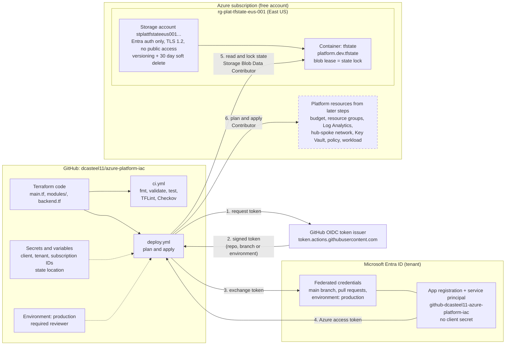
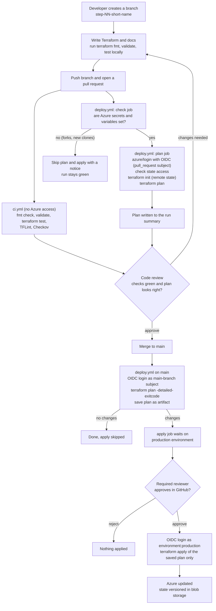

# Architecture

This document describes what has been built so far in `azure-platform-iac`, how the pieces connect, and how a change moves from a developer's branch into Azure. It covers roadmap steps 1 to 4. Later steps (budget, environments, logging, networking, Key Vault, policy, workload, drift detection) will extend it.

## Summary

The platform is a small Azure landing zone managed entirely as code. Today it consists of three layers:

1. **A foundation in Azure**, created once by the [bootstrap script](../bootstrap/README.md): a locked-down storage account that holds Terraform state, and an Entra ID identity that GitHub Actions uses to log in.
2. **A Terraform codebase** in this repo: a root module, a naming and tagging module with unit tests, a remote state backend, and pinned provider versions.
3. **Two GitHub Actions pipelines**: `ci.yml`, which checks every change without touching Azure, and `deploy.yml`, which plans every pull request against the real subscription and applies only after a human approves.

No passwords, client secrets or access keys exist anywhere in the design. GitHub proves who it is to Azure with short-lived OIDC tokens, and the state storage account has shared-key access turned off.

## What was created

### In Azure

| Resource | Name | Purpose and settings |
|----------|------|----------------------|
| Subscription | Azure subscription 1 (free account) | Billing and access boundary for the platform |
| Resource group | `rg-plat-tfstate-eus-001` (East US) | Holds only the Terraform state account, so it is never touched by normal deploys |
| Storage account | `stplattfstateeus001<suffix>` | Standard LRS, StorageV2. TLS 1.2 minimum, HTTPS only, no public blob access, **shared keys disabled** (Entra ID auth only). Blob versioning on, 30-day soft delete for blobs and containers |
| Blob container | `tfstate` | One state file per environment, starting with `platform.dev.tfstate`. Terraform takes a blob lease while it runs, so two runs can never write state at the same time |
| Entra app registration and service principal | `github-dcasteel11-azure-platform-iac` | The identity GitHub Actions logs in as. It has **no client secret** |
| Federated credentials | `main-branch`, `pull-requests`, `env-production` | Entra ID only accepts GitHub OIDC tokens whose subject matches exactly: this repo's `main` branch, its pull requests, or its `production` environment. Subjects use GitHub's ID-based format (`repo:<owner>@<owner-id>/<repo>@<repo-id>:...`), so a deleted repo whose name is reused by someone else can never log in |
| Role assignments | Contributor (subscription), Storage Blob Data Contributor (state account) | What the GitHub identity may do. Contributor can create resources but cannot grant access to anyone else |
| Role assignment | Storage Blob Data Contributor (state account) for the subscription owner | Lets the owner run Terraform from Cloud Shell or a laptop against the same state |

The `<suffix>` is four characters derived from the subscription ID, because storage account names must be unique across all of Azure. Subscription, tenant and client IDs are intentionally not written in this repo.

**Cost:** a few kilobytes of state in LRS storage, well under $0.10 a month. Entra ID objects and role assignments are free.

### In GitHub

| Setting | Value | Purpose |
|---------|-------|---------|
| Repository secrets | `AZURE_CLIENT_ID`, `AZURE_TENANT_ID`, `AZURE_SUBSCRIPTION_ID` | Tell the OIDC login which identity, directory and subscription to use. They are identifiers, not passwords, but stay out of the code |
| Repository variables | `TFSTATE_RESOURCE_GROUP`, `TFSTATE_STORAGE_ACCOUNT`, `TFSTATE_CONTAINER` | Where the remote state lives, passed to `terraform init` |
| Environment | `production`, required reviewer: repo owner | Every apply pauses until a named person approves it |
| Workflows | `ci.yml`, `deploy.yml` | Static checks, and plan/apply against Azure |
| Dependabot | Weekly updates for GitHub Actions and the azurerm provider | Keeps dependencies current through reviewed pull requests |

### In the repo

| Path | What it does |
|------|--------------|
| `bootstrap/bootstrap.sh` | One-time, re-runnable Azure CLI script that creates everything in the Azure table above |
| `backend.tf` | Remote state in Azure Blob Storage with Entra ID auth. Account details come from flags or `backend.hcl`, never from Git |
| `providers.tf`, `versions.tf` | azurerm `~> 5.0`, Terraform `>= 1.6`. No credentials in code |
| `main.tf`, `variables.tf`, `outputs.tf` | Root module. Composes the platform and exposes generated names and tags |
| `modules/naming/` | Cloud Adoption Framework naming (`rg-plat-dev-eus-001`) and five required tags, with `terraform test` unit tests |
| `modules/resource-groups/` | One resource group per purpose (`core`, `app`) per environment, for example `rg-plat-core-dev-eus-001` |
| `environments/` | `dev.tfvars` and `prod.tfvars`; dev is deployed by the pipeline with state key `platform.dev.tfstate`, prod uses `platform.prod.tfstate` (see ADR 0007) |
| `docs/decisions/` | Architecture Decision Records 0001 to 0007 |

## Environment topology

The dashed box is not built yet. Everything else exists today.

## Development to publish workflow

### Controls along the path

| Stage | Control | What it prevents |
|-------|---------|------------------|
| Pull request | `ci.yml` format, validate, unit tests, TFLint, Checkov | Broken, untested or insecure code reaching review |
| Pull request | Real `terraform plan` against Azure, shown on the run page | Reviewers approving code without seeing its effect |
| Merge | Code review on the pull request | Unreviewed changes on `main` |
| Apply | `production` environment with a required reviewer | Any change reaching Azure without a named person's approval |
| Apply | Apply runs the **saved plan file** from the same run | Anything applied that was not in the reviewed plan. A saved plan fails if state changed after it was made |
| Apply | `concurrency` with `cancel-in-progress: false`, plus the blob lease lock | Two deploys writing state at once, or an apply killed halfway |
| Login | OIDC federated credentials scoped to repo, branch, PRs and environment, with ID-based subjects | Stolen or leaked long-lived secrets, and logins from other repos, branches or a re-created repo with the same name |
| Login | `azure/login` and a state access check run before `terraform init` | A bad credential or missing role failing silently. These steps fail in seconds with a readable Entra or storage error |
| State | Versioning, soft delete, Entra-only auth, no public access | Lost or corrupted state, and access with a leaked account key |

## Design decisions

Each significant choice has its own record in [decisions/](decisions/):

- [0001](decisions/0001-terraform-and-azurerm-4.md) Terraform with the azurerm provider
- [0002](decisions/0002-upgrade-to-azurerm-5.md) Upgrade to azurerm 5.x
- [0003](decisions/0003-naming-and-tagging.md) Naming and tagging convention
- [0004](decisions/0004-bootstrap-oidc-and-remote-state.md) Bootstrap with OIDC and remote state
- [0005](decisions/0005-deploy-pipeline.md) Plan on pull request, apply a saved plan on main behind an approval
- [0006](decisions/0006-budget-before-resources.md) A subscription budget before any billable resource
- [0007](decisions/0007-environments-with-tfvars.md) Environments via tfvars files and separate state keys

## Lesson learned during setup

The first real plan hung at `Initializing the backend` with no error. GitHub now sends an ID-based OIDC subject for newer repositories, while the federated credentials were registered with the older name-only subject, so Entra ID rejected the token and Terraform waited silently. Adding an explicit `azure/login` step surfaced the exact error (`AADSTS700213`, with the subject GitHub actually sent), and the bootstrap now registers the ID-based subject and updates older credentials in place. See [bootstrap/README.md](../bootstrap/README.md#troubleshooting).

## Known limits and next steps

- The plan job uses the same Contributor identity as apply. A stricter setup gives plan a read-only identity (noted in ADR 0005).
- There is one state file (`platform.dev.tfstate`). Per-environment state and tfvars arrive in roadmap step 6.
- Next on the roadmap is step 5, a consumption budget with an email alert, so cost guardrails are in place before any billable resources are deployed.
